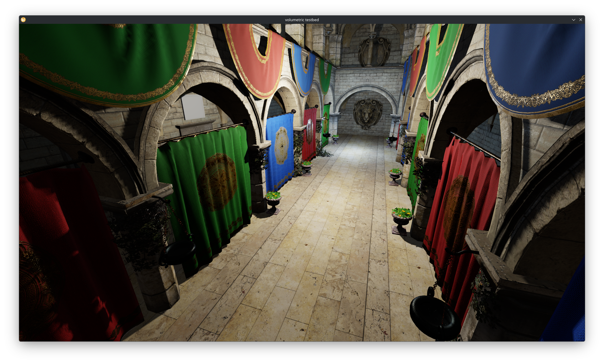
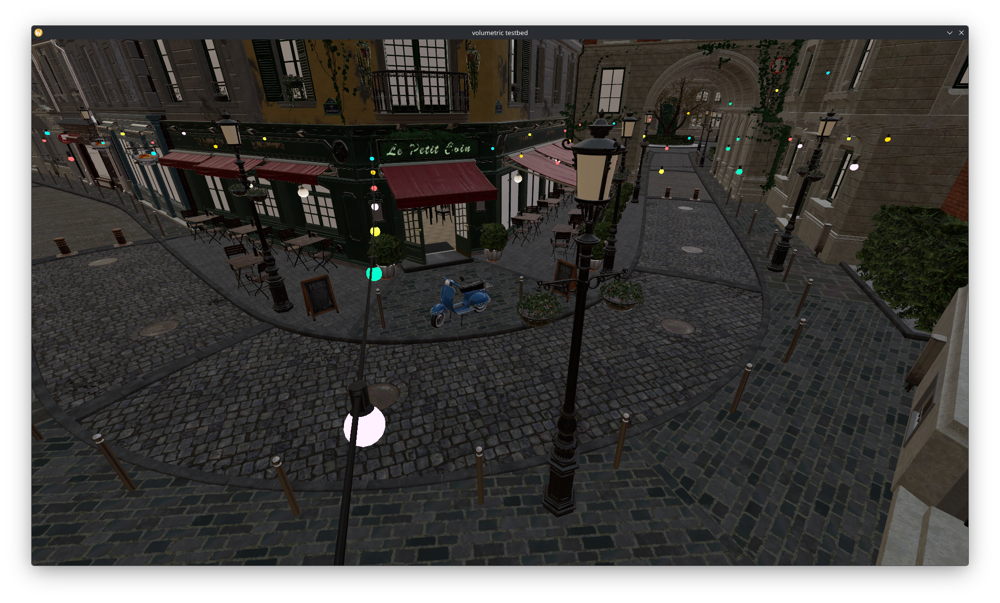
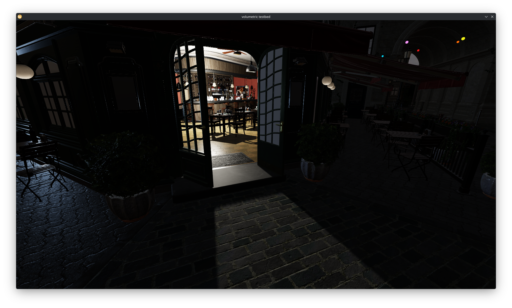
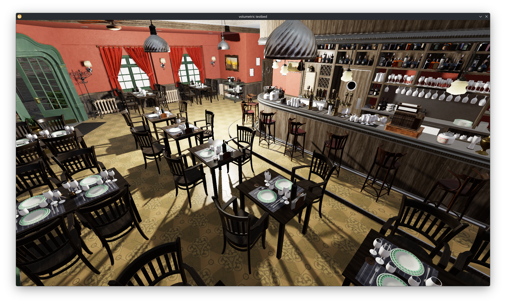
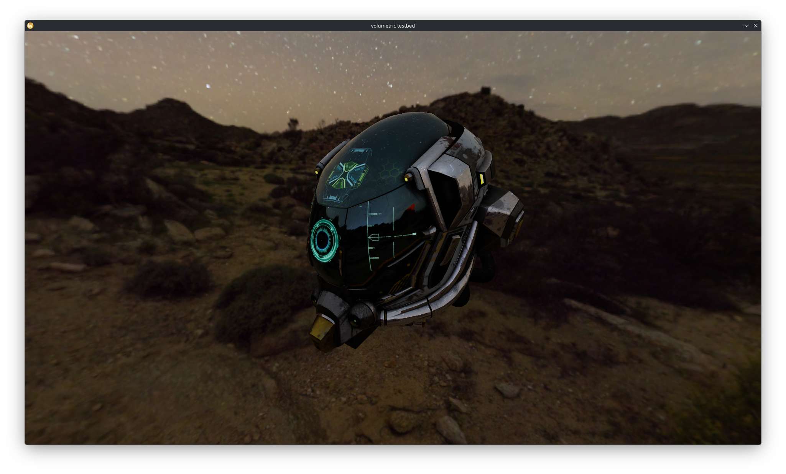

# Magpie

**Magpie** is primarily a fully jobified/multithreaded GPU-driven Vulkan renderer (though it's turning into more of a game framework as I add more features I'm randomly interested in) written in C++. It is currently being used for my 3rd Year project at university, and as a framework onto which I am building a multiplayer game.

(ignore the window titles)

## About the Project
Basically, this is a testing ground for whatever programming project I want to try at any given point. I hope maybe this project helps someone else. Magpie currently sticks to supporting devices running Vulkan 1.3 and higher (with some base extensions), and has an optional features system, such as using hardware raytracing if available. I also assume only one graphics device and such.

Yes, it's over-engineered for a solo project. No guarantees on quality, some of it is probably bad, some of it is maybe good :).

### Resources Used
- Real Time Rendering 4th Edition (i have the physical book it's genuinely awesome)
- Game Engine Architecture 3rd Edition
  - I've used this more for structuring the engine as a whole, it doesn't focus on graphics as much, but I've taken a lot from it and I'd recommend it to anyone learning how to make a game engine, or renderer.
- Vulkan Guide

---

## Notable Features
- **Render Graph** that handles resource management, pipeline barriers, and synchronization
- **Bindless Resource Design**
- **GPU Driven Rendering:** bindless materials and meshes (global vertex buffer, vertex pulling, etc.)
- **Image-Based Lighting** (IBL)
- **Advanced glTF 2.0 material support** transmission, volume, specular, clearcoat, sheen, iridescence, etc.
- **Compute Frustum Culling**
- **Indirect Forward Rendering**
- **Point Lights** with compute-culled shadow-mapping
- **Right-Handed Z-up Coordinates** as it SHOULD be
- **Async Generic Asset Loading**
- **Asset Hot-Reloading**
- **Page-Allocated Geometry Data** in the render scene allowing for efficient mesh data streaming in and out
- **Lockless (almost) fiber-based job system** with an even lower-latency spin mode
- **Controller Support**
- **3D Audio**
- **Debug Rendering** lines, circles, spheres, AABB, OBB, crosses, etc.
- **GPU Profiler**
- **Logging System** with levels, channels (+ sub channels), file output, deduplication, etc.
- **Raytraced Static Irradiance Probes**
- **Skeletal Animation Support** with skinning etc...
- **Scripting Integration** with all top-level systems (using Lua).
- **Naughty Dog-Style Frame System** frames are packed into "frame params" which are then sent to the render system. This a) creates a very clean architecture, as there is a single source of input for the renderer, but also b) creates a massive performance gain, as we can run the rendering multithreaded jobs for the current frame while also running jobs on computing the next frame.
- **Frame Interpolation** based on the highly inluential https://gafferongames.com/post/fix_your_timestep/ article, integrated with the Naughty Dog frame params as listed above.
- **Sorted Forward Transparency**
- **Depth Prepass**

## Roadmap

### Planned Features (in rough order of what's next)
- LOD-based Asset Streaming for Models, Textures, etc...
- Virtual Texturing
- Physically Based Bloom
- ImGui Integration (C bindings)... I keep putting this off
- SSAO (horizon-based none of that random hemisphere stuff)
- Cascaded Shadow Mapping (CSM)
- Advanced Material Rendering
  - [ ] Transmission
  - [ ] Specular
  - [x] Clearcoat
  - [ ] Sheen
  - [ ] Iridescence
  - [x] Unlit Materials
- Forward+ Light Clustering
- Alpha to Coverage for foliage / alpha-cutout geometry
- Advanced Reflections + Reflective Materials (e.g: Mirrors, SSR, Multiple reflection probes)
- Text / Font Rendering
- Multi-Threaded CPU profiler integrated with the Job system (difficult due to fibers, as there is no guarantee a job will start and end on the same thread)
- Visualisation for Profilers (CPU & GPU)
- Dynamic Irradiance Probes which automatically reposition themselves
- 2D Batch Quad Renderer (basically the SpriteBatch from XNA/FNA/MonoGame/LibGDX)
- UI System (needs 2D batch renderer)
- Compositive Post Processing Pipeline
- Refraction

### Mini Project Ideas
- Volumetrics (Clouds, Smoke, etc.)
- Grass / Fur / Hair Rendering
- Realistic Ocean water rendering based on FFT
- Terrain Generator based on No Man's Sky GDC Talk
- Compute particles based on Naughty Dog's *The Last of Us Part II* SigGraph 2020 Talk
- *Half-Life: Alyx* style reticle / gun scope effect (scope is only visible through the front holographic "lens", probably done through stencil magic)

---

### Job System
The job system is effectively at the core of the project. It is a fiber-based job system based off-of the pioneering work of Naughty Dog in their presentation "Parallelizing the Naughty Dog by Christian Gyrling". It's pretty complicated but the basic idea is that using a naiive job queue is that when a job dispatches more jobs and waits on them, the thread running that job stalls when it could be working! This can get even worse, when in some cases it can straight up lead to a deadlock as there might not be any free thread to complete the child job!

To fix this problem, we turn to a thing called a "fiber". The special thing about fibers is that they maintain their own call stack, which allows us to context-switch between any job at any time we want. Therefore, every time we "wait" at a counter (renamed - "Yield" because it's more apt) the fiber running that job context switches to a different job, and once all the jobs that the counter is waiting on are completed, then we resume that job by context-switching back into it.

If you're more curious I wrote a blog post about my implementation approach [here](https://kryzp.github.io/posts/fiber-job-system/).

### Assets
Assets are loaded entirely asynchronously since they're integrated with the job system. However, that leads to a problem, which is that an asset actually goes through multiple stages until it's considered "ready". In a naiive asset system, you typically have a single `Load()` function that handles everything from finding the file on the disk, to load it into memory, and potentally uploading to the GPU. That's pretty terrible because you have to wait for the entire asset to load in before moving on to the next one, when you could be loading multiple in parallel.

You can't just parallelize the whole thing because while loading an asset into memory is super simple, when it comes to things like uploading onto the GPU it's not so simple and we want to minimize the number of command buffers we use / submit. Therefore, I split asset loading into four stages:

1. The Load Stage: This is where we find the file in memory, load it in, and allocate some temporary memory for it. We haven't modified the actual asset record yet. For example, loading in pixel data from a texture file.
2. The Alloc Stage. This is where we actually move that temporary data into the asset and allocate any resources. This has to be seperate from the load stage as memory allocation on the main asset arena has to be synchronised between jobs. In the load stage each job gets its own arena so there's never any contention.
3. The GPU Upload Stage. This is where we upload the data onto the GPU, exposing a command buffer and staging buffer which can be used.
4. The Cleanup Stage. Any temporary data that was allocated in previous stages can be cleaned up here. Only really necessary for external API's (e.g: cleaning up texture data from `stbi`) because we use arenas for everything internally anyway.

Essentially, we parallelize the CPU stage, and try to record as much instructions onto the command buffer in the GPU stage before submitting.

Hooking it up was more "awkward" than "hard" necessarily but it works and that's what matters. It leads to some uncomfortable code when allocating extra data per-asset because we have to do a deep copy of that data (anything allocated using `ctx->scope` in the cpu stage is impermanent) once it gets to the alloc stage but that's fine.

The asset system also supports fancy things like hot-reloading of assets which was also harder than I initially assumed because some assets, like shaders or models, also have dependencies. So, we have to watch those for modifications as well. Fun stuff!

## Scripting
I've implemented a Lua-based scripting system that lies at a pretty low level that allows all layers above it to "hook" into it. I think this is kinda where the layer architecture shines. Anyway it's not the greatest thing in the world but it gets the job done. It's not intended to be used for engine behaviours but when I make games on the side to test out the engine there's often stuff like cutscenes or one-off interactions (idk, talking to a specific shopkeeper) that are just a pain in the ass to do in the C code due to all the systems that have to work together to make it happen, so having a centralized scripting system that lets you just access all systems globally in a contained space is just a really nice QoL feature to have.

### Cool Stuff
Interesting files that you might wanna have a look at if you're just starting with the codebase.

- `os/*` Job System, Logging and Platform layer - Seriously, please check this out, it took me too much blood sweat and tears for this to go unnoticed as just some boring low-level stuff.
- `render/*`
- `render/graph/*`
- `assets/*`
- `graphics/*` Low-Level Vulkan abstraction

## QnA

> Where's the cool engine UI?????

...

> Can I use this to make my own games?!

Don't. I mean, you can, and I'm not gonna stop you. But don't.

> Do you use AI???

No. NO. I also hate that I have to clarify that none of this is vibecoded. This is actually something I care about, and put time into. Check the commit history if you don't believe me.

> What's the history? How long did this take?

This isn't my first Vulkan or game engine project. If you look into the repository's history, it's gone through about 3-4 separate re-writes.

## External Libraries
This project is built upon the shoulders of- yeah you've heard it all before. All external libraries are found in `ext/`

- SDL3
- Vulkan + Vulkan Memory Allocator + Volk
- Slang Compiler
- cgltf
- ImGui
- miniaudio
- STB headers
- Lua
